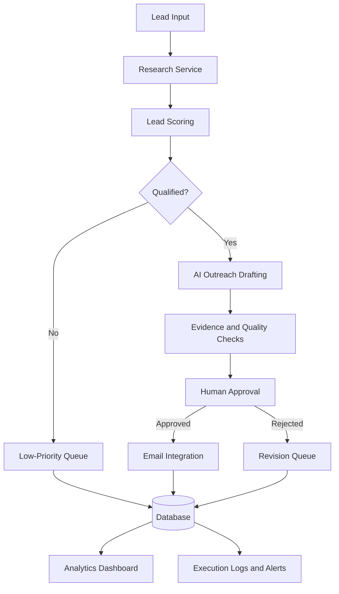

# GrowthPilot AI 🚀
### AI-Powered Growth Operations Agent

**Status: In progress**

GrowthPilot AI is a project to build an AI-assisted growth operations system for small B2B SaaS teams. It aims to streamline lead research, qualification, personalized outreach preparation, workflow automation, and growth analytics.

The goal is to reduce repetitive work while keeping important business decisions and external communications under human control.

## Problem Statement

Early-stage startups often manage prospect research, lead qualification, outreach preparation, and performance tracking manually. These disconnected workflows consume time and make it harder to prioritize promising opportunities.

GrowthPilot AI explores how AI, automation, and structured business rules can bring these activities into one reliable workflow.

## Planned Features

- **Lead Research:** Collect and organize company and prospect information from permitted sources.
- **Lead Qualification:** Score prospects against configurable criteria and explain the reasoning.
- **AI-Assisted Outreach:** Generate personalized email drafts grounded in available evidence.
- **Human Approval:** Review, edit, approve, or reject drafts before sending.
- **Workflow Automation:** Track execution status, retries, failures, and follow-up tasks.
- **Growth Analytics:** Track qualification rates, workflow completion, costs, and other relevant metrics.

## Architecture

*This diagram represents the planned architecture; components will be implemented and validated incrementally.*

## Proposed Technology Stack

- **Backend:** Python, FastAPI
- **AI:** LLM API with structured outputs and evaluation checks
- **Database:** PostgreSQL
- **Dashboard:** Streamlit for the initial prototype
- **Integrations:** Approved research sources, email sandbox, and optional Slack notifications
- **Testing:** Pytest and mocked external services
- **Deployment:** Docker and CI/CD

The stack may evolve as implementation and testing reveal better choices.

## Engineering Principles

- Use deterministic code for business rules, permissions, and workflow state.
- Use AI where language understanding and generation provide clear value.
- Ground generated content in available evidence and flag uncertainty.
- Keep external communication behind human approval.
- Handle retries, duplicate actions, API failures, and partial workflow completion.
- Evaluate quality, latency, cost, and reliability using repeatable tests.
- Avoid storing secrets or personal information unnecessarily.

## Development Roadmap

- [ ] Define data models and lead qualification criteria
- [ ] Build the initial API and sample-data workflow
- [ ] Implement lead research and evidence tracking
- [ ] Add deterministic lead scoring
- [ ] Implement AI-assisted outreach drafting
- [ ] Add quality checks and human approval
- [ ] Persist workflow states and execution logs
- [ ] Build the growth analytics dashboard
- [ ] Add automated tests and failure recovery
- [ ] Containerize and deploy a working demo
- [ ] Document evaluation results and known limitations

## Current Status

**In progress — initial project setup.**

The architecture and implementation plan are being established. Features will be marked complete only after implementation and testing.

## Success Metrics

The project will evaluate:

- Lead research completeness and factual accuracy
- Agreement between lead scores and a defined evaluation rubric
- Unsupported claims in generated outreach
- Workflow success rate and failure recovery
- Cost and latency per processed lead
- Estimated time saved compared with a manual baseline

Metrics will be reported only after experiments have been run.

## Project Scope

This is an independent portfolio project and is not affiliated with or endorsed by Slidely AI. No customer data or proprietary company systems are used.
